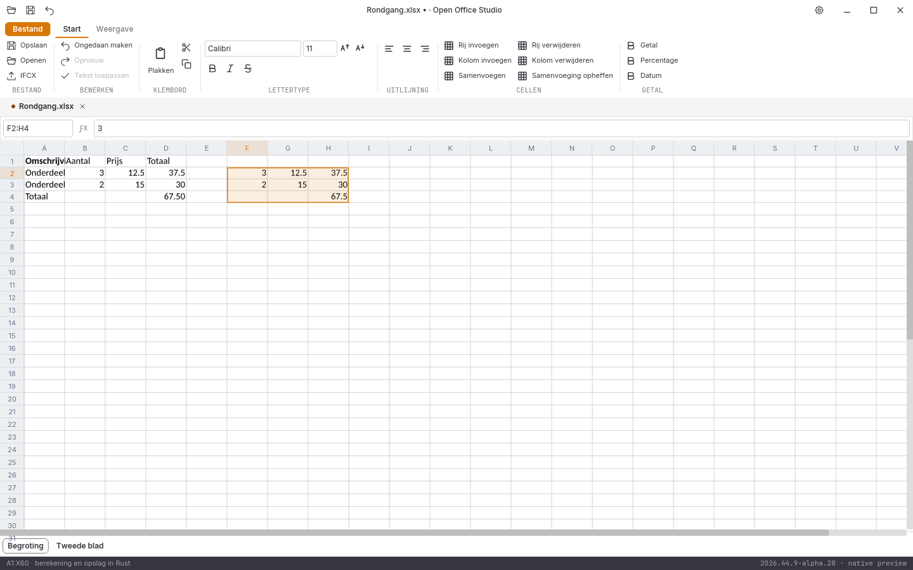
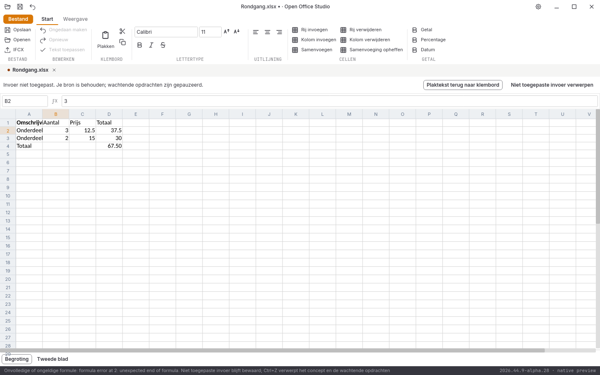

# Native controle, 1 november 2026: alpha 27

**2026.44.9-alpha.27** ordent de inline-invoer in Spreadsheet en voegt een plat celbereikklembord toe. De volledige suite en alle tien acceptatiegebieden blijven open.

## Wat verandert

Pijlen, typen, F2, Enter/Tab, klembordopdrachten, bronwerk en bewaarsnapshots blijven in gebruikersvolgorde. Een werkelijk lopende werkvensterwissel mag verdere celinvoer niet weggooien. Ook invoer uit dezelfde oude inline-editorwidget werkt na Enter op de nieuwe cel. Tijdens de bewaakte focusoverdracht blijven toetsen en een synthetische IME-Commit bij de huidige editor. Tekstbediening in het zijpaneel en bewaren vanuit de sluitvraag behouden hun eigen werking.

Waarden kopiëren leest opgemaakte platte tekst rechtstreeks uit dezelfde werkmap op de werkdraad. De lintknop noemt dit expliciet **Waarden kopiëren**. Plakken ondersteunt tabs, CR/LF/CRLF, geciteerde velden, meerdere regels in één veld, dubbele aanhalingstekens, Unicode en lege randen. Eén ankercel laat het blok uitbreiden; een passend geselecteerd bereik herhaalt het blok. Alle invoer wordt vóór één gezamenlijke enginebewerking gecontroleerd; formules worden gezamenlijk herberekend. Wissen leegt de geselecteerde inhoud met behoud van opmaak. Kopiëren draagt geen rijke opmaak of verplaatste formulereferenties over; bereik verplaatsen/knippen blijft open.

Vertraagde klembordantwoorden hebben een document, bronversie en doel. Een ander tabblad of modaal venster mag de tekst niet ontvangen. De oorspronkelijke opdracht hervat pas bij het juiste document en doel. Een gewijzigd doel wordt afgekeurd. Een ongeldige late formule verandert geen enkele cel; vervolgopdrachten pauzeren en de afgekeurde plaktekst kan naar het klembord worden teruggehaald. De gebruiker kan niet toegepaste invoer expliciet verwerpen. Grenzen van 10.000 cellen, 4 MiB platte tekst en 256 wachtende opdrachten voorkomen onbegrensd werk. Bufferweigeringen blijven zichtbaar tot ze worden bevestigd.

## Gecontroleerd

- **307 reguliere Rust-tests geslaagd**, inclusief **102 tests in de UI-crate**; zes runtimeproeven en zeven Python-tests geslaagd.
- Rustfmt, Clippy met waarschuwingen als fouten, gepinde bronhashcontroles en onafhankelijke DOCX/XLSX/PPTX-/conversielezers geslaagd. De **612 bronbestanden** blijven vóór en na de controles bytegelijk.
- [Zes nieuwe kernproeven, drie celtekstproeven en veertien UI-proeven](spreadsheet-klembord-2026-11-01-alpha27.json) controleren blokplakken, kopiëren, herberekening, Unicode, geciteerde tekst, lege cellen, tegelvulling, merges, bescherming, matrixformules, bronexacte undo/redo, snelle invoer, modaliteit, tabwissel, ongeldige doelen/formules, blijvende bufferwaarschuwing en bewaren bij sluiten. Geen kwantitatieve functiedekking.
- [49 volledige native widgetbeelden](schermen-2026-11-01-alpha27.json); vijftien gedeelde documentbeelden en acht letterbeelden blijven bytegelijk aan alpha 26. Vijf oorspronkelijke renderer-goldens blijven gecontroleerd. Geen fysieke hardwareproef; de echte CI-Linux-releasevensterproef staat hieronder afzonderlijk vastgelegd.
- Onafhankelijk teruglezen bevestigt B2=7, C2=8, B3=9, C3=SUM(B2:C2), D2=56, D3=135 en D4=191. Unicode, meerregelige tekst, letterlijke 0012, bestaande opmaak/formules en het tweede blad blijven behouden. De UI-kopie bevat de opgemaakte waarden; er zijn geen formulereferenties verschoven.
- [Zes conversierondgangen en drie PDF-handtekeningen](conversie-2026-11-01-alpha27-lokaal.json) onafhankelijk gecontroleerd. [De oorspronkelijke afkeuringen](invoerdiagnoses-2026-11-01-alpha27/LEESMIJ.md) blijven behouden.

De [lokale alpha-27-releasebouw](bouw-2026-11-01-alpha27-lokaal.json) slaagt in **31m12s**, inclusief pakket-/bronregressiecontrole en beide programma’s vastgezet. De [echte CI-Linux-releasevensterproef](vensterproef-2026-11-01-alpha27-ci/LEESMIJ.md) slaagt op **achttien gerichte stappen**, waaronder directe plak/Enter/bewaren, opeenvolgende celinvoer, bronexacte undo en Unicode na heropenen. De eerste onvoldoende Bestand-controle blijft afzonderlijk afgekeurd. De [volledige alpha-27-platformronde](platformen-2026-11-01-alpha27.json) slaagt op vijf taken: **1297 bytegelijke bronbestanden per pakket**, **98 volledige native beeldparen** zonder tolerantie en **21 releasepaginabezoeken**. De [lokale alpha-26-releasebouw](bouw-2026-11-01-alpha26-lokaal.json) slaagt in **29m56s**, met beide programma’s vastgezet en pakket-/broncontrole. De [alpha-26-platformronde](platformen-2026-11-01-alpha26.json) slaagt op vijf taken: **1240 bytegelijke bronbestanden per pakket**, **94 volledige native beeldparen** zonder tolerantie en **21 paginabezoeken**. De [echte lokale alpha-26-vensterproef](vensterproef-2026-11-01-alpha26-lokaal/LEESMIJ.md) slaagt op veertien gerichte stappen; de voorafgaande scriptfout blijft afzonderlijk afgekeurd. Die goedkeuring geldt voor de vastgelegde alpha-26-programma’s.

## Open acceptatie

De [vier volledige oorspronkelijke UI-vergelijkingen](pixelcontrole-alpha27/rapport.json) blijven rood: Writer **108.314**, Spreadsheet **382.431**, Presentation **560.039**, Notition **666.031** afwijkende pixels, elk op 943.736 pixels. Geen maskers, herschaling of kleurtolerantie. Versieletters beïnvloeden de telling; geen maat voor functiedekking.

De nieuwe modeluitvoer verliest [sheetFormatPr waaronder zeroHeight](modeluitvoer-diagnose-2026-11-01/LEESMIJ.md). Verder blijven volledige formulebalk-/zijpaneelwachtrij, overige Home/End-/woordtoetsen rond focuswisseling en rijke opmaak tijdens conceptinvoer, rijke celkopie/formuleverschuiving en bereikverplaatsing, virtualisatie/autoscroll, volledige rasterbediening, rijke Writer-editor/ribbons, presentatieobjecten, notitieherstel, complete mailbediening, database-interface, overige import/afdrukken, native installers/losse edities en fysieke platform-, IME-, systeemdialoog- en schermlezerproeven open. Geen volledige functie-, test- of pixelpariteit en geen stabiele native vrijgave.
