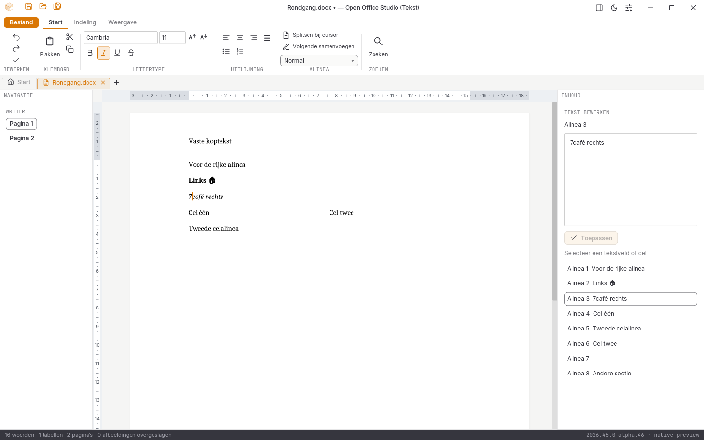
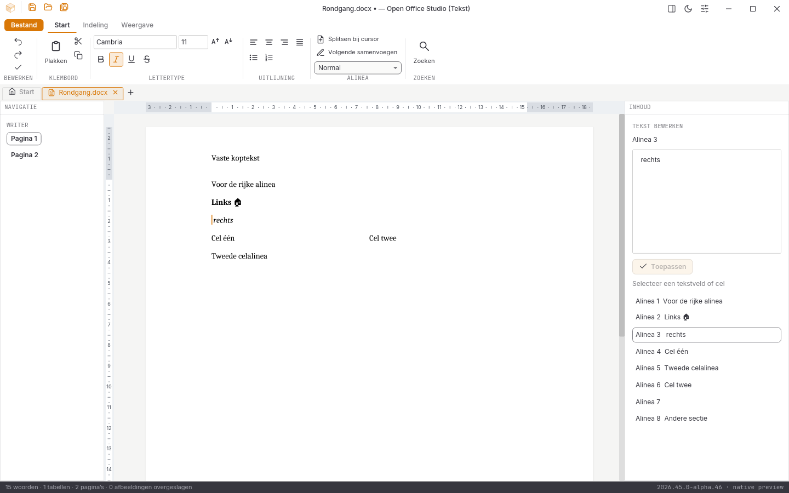

# Native controle, 1 november 2026: alpha 29

**2026.44.9-alpha.29** verbindt de alineastructuur met directe Writer-paginainvoer. Enter maakt een echte nieuwe alinea; Shift+Enter blijft een zachte regelovergang. Een selectie verwijderen en splitsen gebeurt in één brontransactie. Backspace en Delete voegen op de alineagrens uitsluitend aangrenzende alinea’s binnen dezelfde tekst of tabelcel samen. De cursor keert terug op de verwijderde grens. Bestaande runopmaak, invoer in de nieuwe lege alinea, snelle vervolgtekst en bronexacte undo/redo blijven behouden.

- **328 reguliere Rust-tests geslaagd**, inclusief **118 UI-tests**; zes runtimeproeven en zeven Python-tests geslaagd.
- Rustfmt, Clippy met waarschuwingen als fouten, gepinde bronhashcontroles en onafhankelijke bestands-/conversielezers geslaagd. **615 bronbestanden** blijven vóór en na de controles bytegelijk.
- [Vijf nieuwe kern- en negen widgetproeven](writer-alineatoetsen-2026-11-01-alpha29.json), met vijf onafhankelijk teruggelezen DOCX-bestanden. De [oorspronkelijke drie afkeuringen en de eerste afgekeurde implementatie](invoerdiagnoses-2026-11-01-alpha29/LEESMIJ.md) blijven behouden.
- [51 volledige native widgetbeelden](schermen-2026-11-01-alpha29.json). Vijftien gedeelde documentbeelden en acht letterbeelden blijven bytegelijk aan alpha 28; vijf oorspronkelijke renderer-goldens blijven gecontroleerd.

De [lokale alpha-29-releasebouw](bouw-2026-11-01-alpha29-lokaal.json) slaagt in 27m06s. Beide programma’s zijn op versie en SHA-256 vastgezet; pakket- en bronregressiecontrole slagen. De [echte lokale Linux-Writer-vensterproef](vensterproef-2026-11-01-alpha29-lokaal/LEESMIJ.md) slaagt op achttien gerichte stappen, met werkelijk systeemklembord en opnieuw openen. De [echte CI-Linux-Writer-vensterproef](vensterproef-2026-11-01-alpha29-ci/LEESMIJ.md) slaagt afzonderlijk op dezelfde achttien stappen. De drie CI-platformbuilds en conversietaak slagen, maar de gezamenlijke platformvergelijking van ronde `41265333745` faalt vóór de beeldvergelijking: de workflow verwacht nog 49 beelden terwijl er 51 zijn. Die afkeuring blijft behouden; de verwachting wordt voor de volgende bronversie op de werkelijk aanwezige 51 beelden gezet. Deze CI-ronde wordt niet als geheel goedgekeurd. De afzonderlijke [lokale hertelling van dezelfde CI-beelden](ci-diagnose-2026-11-01-alpha29/LEESMIJ.md) slaagt op 102 volledige beeldparen met nul afwijkende pixels; 21 releasepaginabezoeken slagen afzonderlijk.

De [vier volledige oorspronkelijke UI-vergelijkingen](pixelcontrole-alpha29/rapport.json) blijven rood: Writer **108.318**, Spreadsheet **382.435**, Presentation **560.043**, Notition **666.031** afwijkende pixels, elk op 943.736 pixels. Geen maskers, herschaling of kleurtolerantie; versieletters beïnvloeden de telling. Geen functiedekkingspercentage.

Alle tien acceptatiegebieden blijven open. Volledige rijke Writer-/ribbonbediening, opmaak kiezen op lege posities, selecties over alinea’s, rijke klembordinhoud, volledige rasterbediening, presentatieobjecten, notitieherstel, complete mailbediening, database-interface, overige import/afdrukken, installers/losse edities en fysieke platform-/IME-/systeemdialoog-/schermlezerproeven ontbreken nog. Nieuwe modelwerkmapuitvoer verliest nog sheetFormatPr waaronder zeroHeight. Geen volledige functie-, test- of pixelpariteit en geen stabiele native vrijgave.
