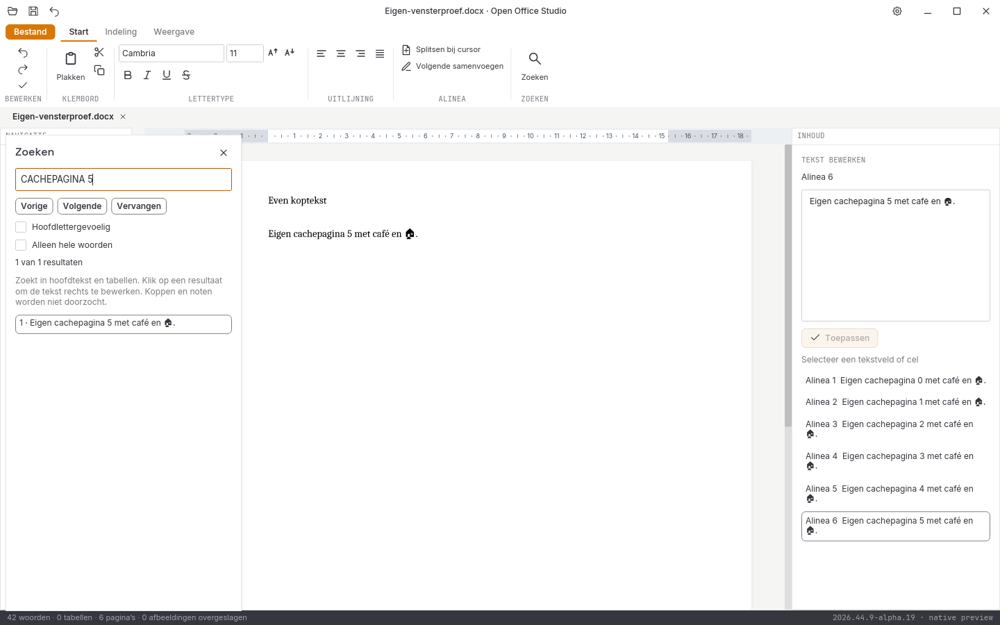

# Werkelijke Writer-paginanavigatie in de Linux-release van alpha 19

Deze afzonderlijke native vensterproef gebruikt dezelfde gecontroleerde
Linux-binary en [herkomst](herkomst.json) als de [twaalfstappenproef](../vensterproef-2026-10-31-alpha19-release/LEESMIJ.md).
Alle 944 verpakte bronbestanden zijn bytegelijk aan het vaste Git-archief
`77c83c8bd06427c786e0e7385e720d4534f2718a`. De [proefbron](proefbron.py),
[uitvoer](rapport.json) en vier volledige vensterbeelden zijn behouden.
Alle opgenomen bronhashes zijn tegen die commit gecontroleerd.

De proef opent de eigen zesbladige fixture. Vanuit de eerste pagina wordt
via het echte zoekveld naar de zesde, terug naar de eerste en opnieuw naar
de zesde pagina gegaan. **Alle drie papierblokvergelijkingen zijn exact**:
het vaste blok `(360, 270, 1080, 380)` bevat de onderscheidende kop- en
bodytekst. De zesde pagina gebruikt het in dezelfde alpha-19-bron opgenomen
widgetbeeld; de eerste pagina gebruikt haar oorspronkelijke vensterbeeld.
De twee verwachtingen moeten vooraf daadwerkelijk verschillen. Er wordt
niet geschaald, gemaskeerd of met kleurtolerantie vergeleken.

Dit is uitsluitend een functionele controle van dat papierblok. Het is geen
volledige schermvergelijking en geen bewijs van gelijkheid aan de oude UI.
De volledige ruwe beelden blijven beschikbaar voor inspectie.

De query gebruikt hoofdletters; na aanklikken moet het vooraf anders gevulde
systeemklembord de echt geselecteerde bronwoorden in kleine letters krijgen.
Daarmee kan kopiëren uit het zoekveld geen vals geslaagd resultaat opleveren.
De documentbytes blijven na alle bezoeken en bewaren exact gelijk. Het
eigen venster sluit zonder bewaarvraag met procescode nul. Alle **acht**
controlestappen slagen.

De proef draait in eigen Xvfb-/D-Bus- en XDG-mappen. Andere modules, fysieke
hardware, Windows/macOS-bediening, IME-compositie, systeemdialogen en een
volledige directe paginacursor zijn niet getest.

