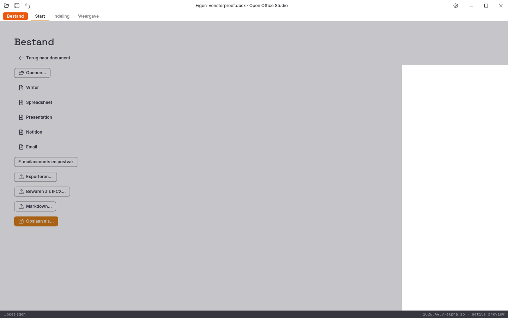

# Echte Linux-vensterproef van alpha 16

De gebruikte releasebinary komt uit CI-ronde `41198879868`; alle 821 verpakte
bronbestanden zijn lokaal bytegelijk aan commit
`9553ae9e7e0789b89c21fc030e81a75965aa60a1` gecontroleerd. De CI-mergecommit is
`78b6a14dceacb24780930d216c88c83c7afd03c4`; alle relevante bronpaden zijn gelijk.

De proef gebruikt een eigen Xvfb- en D-Bus-sessie, een eigen bronkopie en
aparte XDG-mappen. De ruwe [proef](proefbron.py), [uitvoer](rapport.json) en
volledige vensterbeelden zijn behouden. Dit is geen fysieke hardware-,
Windows-, macOS-, IME-compositie-, systeemdialoog- of schermlezerproef.

De echte toetsen en het systeemklembord hebben beide invoegingen, behoud van
vette/cursieve middentekst, Unicode-kopiëren/plakken, toepassen, bewaren en
twee undo-stappen gecontroleerd. De bewaarde DOCX wordt onafhankelijk via XML
gelezen. Na undo komen de oorspronkelijke bestandsbytes exact terug.

De volledige ronde is **afgekeurd** bij de aansluitende visuele Bestand-proef.
Visuele inspectie toont dat Bestand wel opent en de ribbon verdwijnt, maar
het werkvlak grijze tekenresten houdt. De fouttekst van de controller noemt
ook een mogelijk achtergebleven ribbon; dat is hier niet de waargenomen
fout. De verse volledige softwareframes van de platformvergelijking missen
deze fout bij gedeeltelijk hertekenen. Alpha 17 voegt daarom afzonderlijke
pixelproeven voor behouden buffers en afgebakende renderercorrecties toe.

