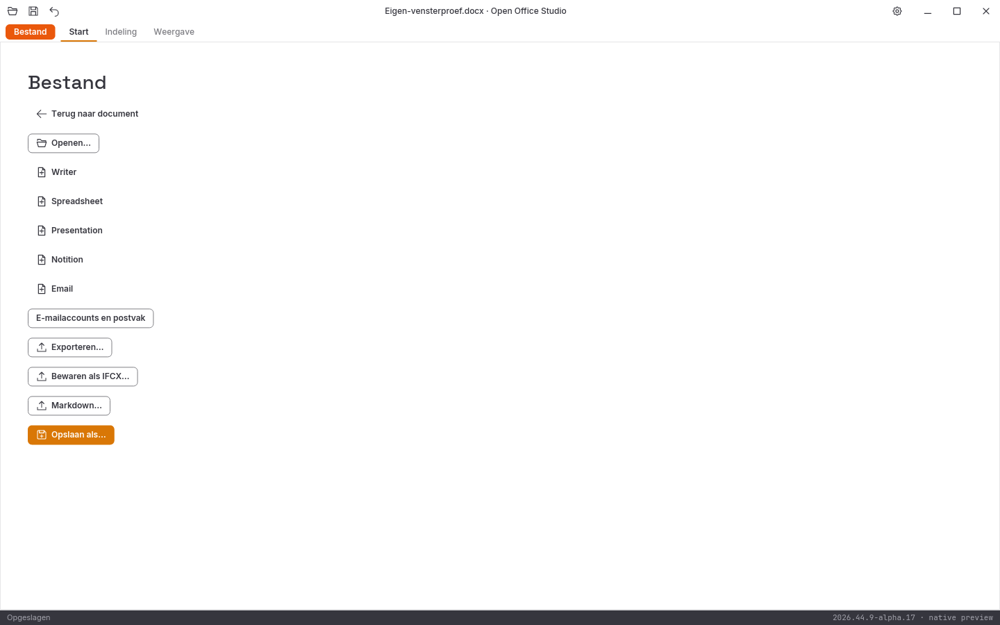

# Geslaagde Linux-releasevensterproef van alpha 17

De gebruikte releasebinary komt uit CI-ronde `41206078246`. Alle **877**
verpakte bronbestanden zijn lokaal bytegelijk aan het Git-archief van commit
`bcb4b2466728420724b68bc8bc26e361123a3acc` gecontroleerd. Ook alle Rust- en
Cargo-bronhashes uit de vensterproef zijn afzonderlijk tegen die commit
gecontroleerd. De [herkomst](herkomst.json) bevat beide programmahashes.

De [ruwe proef](proefbron.py), [uitvoer](rapport.json) en volledige
vensterbeelden zijn onbewerkt behouden. De proef gebruikt een eigen Xvfb- en
D-Bus-sessie, een eigen synthetische bronkopie en aparte XDG-mappen. De
bestaande gebruikersvensters en bestanden worden niet bediend.

De volledige gerichte ronde is **geslaagd**:

- Openen en beide uiteinden van een rijke alinea wijzigen met echte toetsen.
- De oorspronkelijke vette en cursieve middentekst onafhankelijk via DOCX-XML teruglezen.
- Werkelijk X11-systeemklembord kopiëren/plakken met Unicode en bewaren.
- Twee undo-stappen en bewaren herstellen de oorspronkelijke bronbytes exact.
- Snelle Ctrl+A/Ctrl+X kopieert de juiste tekst naar het echte systeemklembord; de lege alinea wordt bewaard. Terugplakken en opnieuw twee undo-stappen herstellen de bronbytes exact.
- Bestand openen: document en ribbon verdwijnen, het witte werkvlak blijft vrij van grijze tekenresten.
- Escape herstelt het documentwerkvlak; de eigen sluitknop sluit met procescode nul.

Dit bewijst deze gerichte Linux/X11-releaseronde. De eerder mislukte debugproef
blijft afzonderlijk behouden. Fysieke hardware, Windows/macOS-bediening,
IME-compositie, systeemdialogen, schermlezers, overige modules en volledige
functie- of pixelpariteit zijn hiermee niet goedgekeurd.

