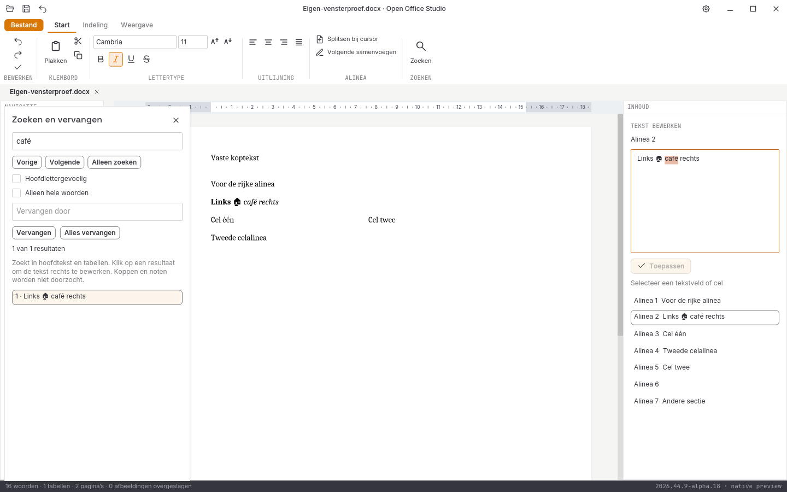

# Geslaagde Linux-releasevensterproef van alpha 18

De binary komt uit de Linux-taak van CI-ronde `41210659697`, broncommit
`e434dfa9c1ce27af1c6147ba3b44fceb48d1e10d`. Alle **911** verpakte bronbestanden
zijn lokaal bytegelijk aan het vaste Git-archief gecontroleerd. Alle Rust- en
Cargo-bronhashes in de [uitvoer](rapport.json) zijn ook afzonderlijk tegen die
commit gecontroleerd. De [herkomst](herkomst.json) vermeldt beide binaries.

De [proefbron](proefbron.py), uitvoer en acht volledige vensterbeelden zijn
onbewerkt behouden. De proef gebruikt een eigen Xvfb-/D-Bus-sessie, een eigen
synthetische bronkopie en aparte XDG-mappen.

De gerichte ronde met twaalf stappen is **geslaagd**. Ctrl+H opent het
zoekpaneel; Unicode-zoektekst komt via het echte systeemklembord binnen.
Een klik op het resultaat geeft de alinea-editor focus. De controller zet
het klembord eerst op andere tekst en controleert daarna dat Ctrl+C precies
de geselecteerde treffer kopieert. Zo kan de eerder geplakte zoektekst geen
vals geslaagde kopieercontrole veroorzaken.

Vervangen met Unicode, bewaren en het behoud van vette/cursieve runs worden
onafhankelijk via DOCX-XML gecontroleerd. Eén Escape vanuit het tekstveld
sluit het paneel; één undo en bewaren herstellen exact de oorspronkelijke
bronbytes. Daarna slagen ook de bestaande rijke invoerreeks, kopiëren/plakken,
snelle Ctrl+A/Ctrl+X, terugplakken, afzonderlijke undo-stappen, Bestand zonder
grijze tekenresten, Escape terug en sluiten met procescode nul.

De oorspronkelijke CI-ronde keurt haar afsluitende platformvergelijking af
omdat de workflow nog 37 schermen verwachtte in plaats van de 38 met het
zoekpaneel. De drie platformbuilds en runtimecontrole slagen. De telling is
in een afzonderlijke CI-correctie aangepast; deze vensterproef blijft bij de
oorspronkelijke Linux-binary en broncommit horen.

Dit bewijst deze Linux/X11-releaseronde. Fysieke hardware, Windows/macOS-
bediening, IME-compositie, systeemdialogen, schermlezers, overige modules en
volledige functie- of pixelpariteit zijn niet goedgekeurd.

