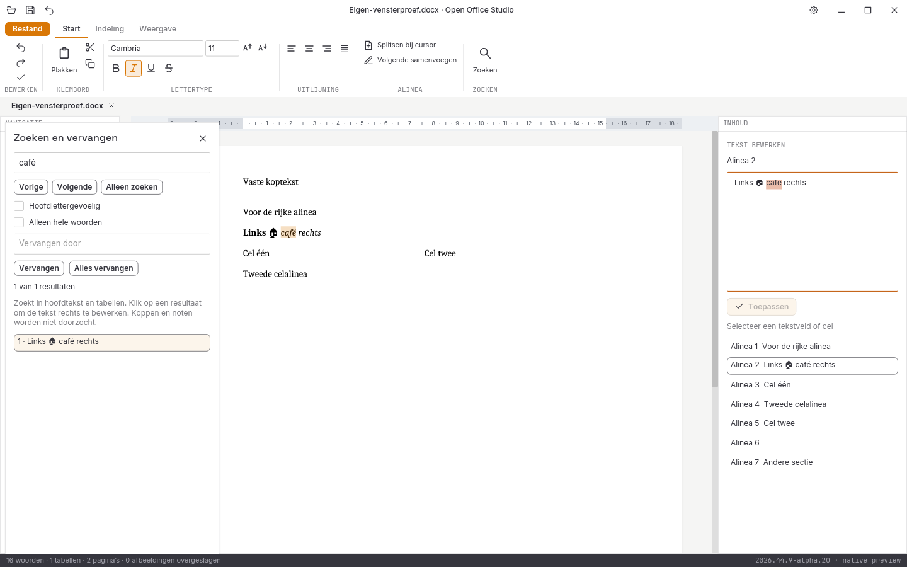

# Geslaagde Linux-releasevensterproef van alpha 20

De binary komt uit de Linux-taak van [CI-ronde 41222311428](https://github.com/OpenAEC-Foundation/open-office-studio/actions/runs/41222311428),
broncommit `963258d7b6b24b30912f1cd21e5a29882d638c80`. Alle **987** verpakte
bronbestanden zijn bytegelijk aan het vaste Git-archief gecontroleerd.
[Herkomst](herkomst.json), [proefbron](proefbron.py), [uitvoer](rapport.json)
en acht volledige vensterbeelden plus de afzonderlijke widgetreferentie zijn onbewerkt bewaard. De proefbronhash en
alle opgenomen Rust-/Cargo-bronhashes zijn tegen deze commit gecontroleerd.

De gerichte ronde slaagt op **twaalf stappen**: zoeken openen, Unicode-invoer
via het systeemklembord, resultaat aanklikken en echte editorfocus, selectie
kopiëren na vooraf gewijzigd klembord, Unicode-vervanging, bewaren met
onafhankelijke XML-controle van runopmaak, één Escape, exacte bronherstelling
via undo, rijke invoer, snelle Ctrl+A/Ctrl+X, terugplakken, Bestand zonder
grijze resten en schoon sluiten.

Dit gebruikt een eigen Xvfb-/D-Bus-sessie en aparte XDG-mappen. Het is een
gerichte Linux/X11-releasecontrole. Fysieke hardware, Windows/macOS-bediening,
IME-compositie, systeemdialogen, schermlezers, overige modules en volledige
functie- of pixelpariteit zijn hiermee niet goedgekeurd.

De [markeervergelijking](markeervergelijking.json) meet **nul afwijkende pixels** binnen het vaste documentblok van het echte venster tegenover de widgetreferentie van dezelfde commit. Dit is een gerichte functiecontrole, geen volledige venster- of legacypariteit.
