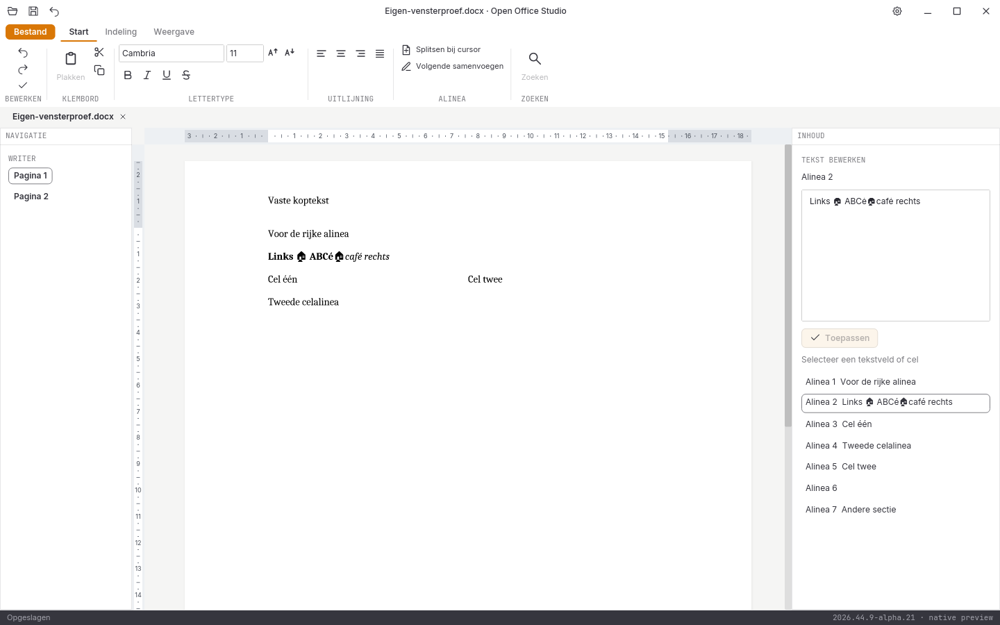

# Directe pagina-invoer in de echte alpha-21-release

De [binaryherkomst](herkomst.json) hoort bij broncommit `e30f3a84b75a018c7e348d1c5b47f3d2010e85d8` en [CI-ronde 41231100491](https://github.com/OpenAEC-Foundation/open-office-studio/actions/runs/41231100491). Alle **1039** verpakte bronbestanden zijn tegen het vaste Git-archief gecontroleerd. De [proefbron](proefbron.py), [elf geslaagde stappen](rapport.json) en volledige vensterbeelden zijn behouden; bron-, binary- en proefhashes zijn gecontroleerd.

Een echte muisklik op de documenttekst activeert de paginacursor. Snelle ASCII-toetsen, Unicode-plakken en onmiddellijk bewaren leveren de verwachte tekst op. De vette oorspronkelijke tekst, vette ingevoegde tekst op de rungrens en cursieve resttekst zijn onafhankelijk via DOCX-XML gecontroleerd. Afzonderlijke undo’s herstellen de plakgroep en daarna de **exacte oorspronkelijke pakketbytes**. Ook snel selecteren/knippen, het echte systeemklembord, terugplakken op de lege pagina, bronexacte undo, zoeken, één Escape en direct typen zonder extra focusklik, Bestand vóór de ribbon en schoon sluiten zijn gecontroleerd.

De [eerste proef](afgekeurd.json) met haar [bron](afgekeurde-proefbron.py) en foutbeeld blijft behouden. Zij verwachtte ten onrechte cursieve invoegtekst op een rungrens. De implementatie erft daar de opmaak van de linker run: de invoegtekst is vet, terwijl de ongewijzigde cursieve resttekst correct blijft behouden. De geslaagde proef toetst beide brondelen en de invoegtekst afzonderlijk; er is geen formatteringstest verwijderd en geen pixelmasker toegevoegd.

Eigen Xvfb-, D-Bus- en XDG-sessie. Deze gerichte Linux/X11-releaseproef keurt geen fysieke hardware, Windows/macOS-bediening, echte IME-compositie, systeemdialogen, schermlezers, overige modules of volledige functie-/pixelpariteit goed.

